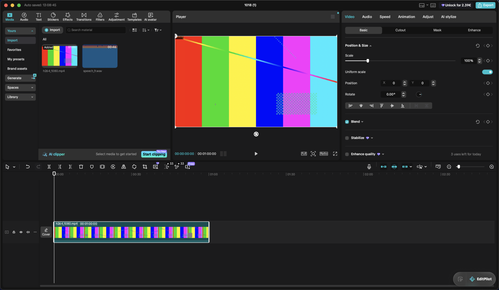
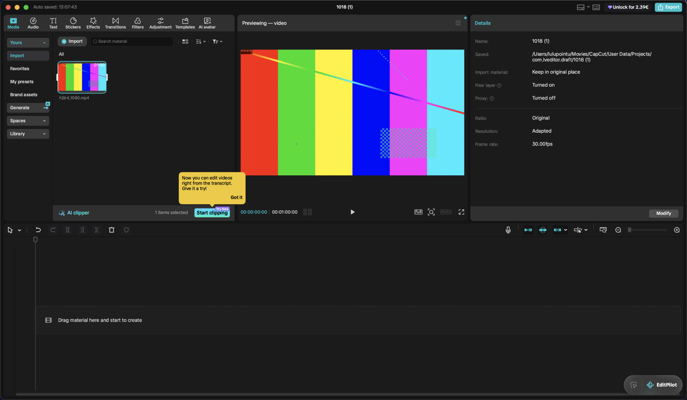
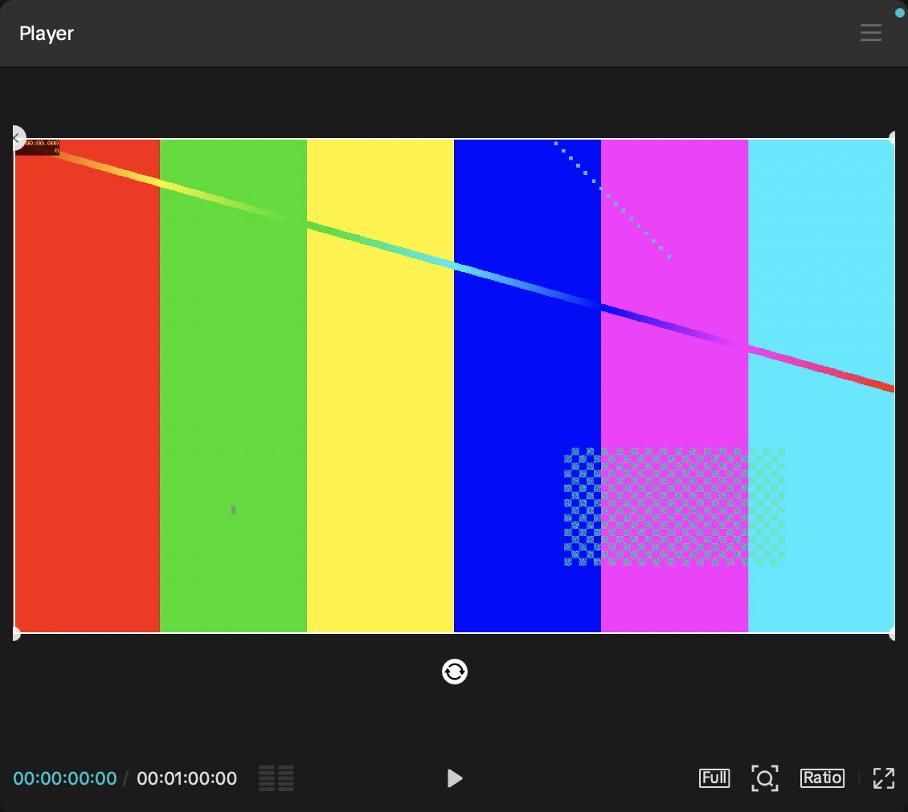
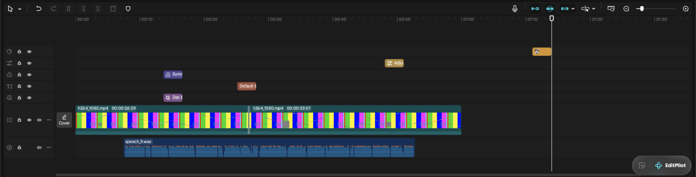
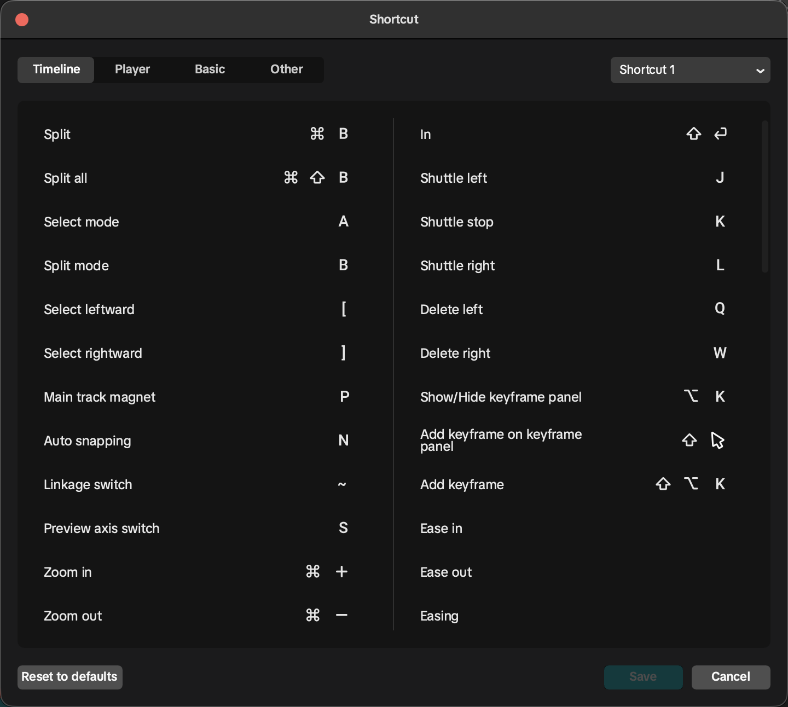

# Montage UX reference: how CapCut desktop looks and behaves

Source: hands-on session with **CapCut for macOS 9.6.0** (Qt/QML + CEF app, bundle id `com.lemon.lvoverseas`) on a 1728×1117 pt
Retina screen, English UI, October 2026. Screenshots are in `docs/ux/`. Every size is in **points** (pt = 1 macOS logical pixel).
Colors were sampled from full-resolution screenshots (sRGB). French terms come from the app's own `Resources/po/fr-FR.po`
(see §10).

> Clone the **behaviour and feel** (layout, densities, flows, feedback). Don't copy CapCut's upsell surfaces: "Pro" diamonds,
> "Unlock for 2.39€", "x uses left for today", sign-in, cloud "Spaces" and coach-mark popups. Montage has none of these. They are
> listed below only so you know what to leave out.

---

## 1. Global layout and visual language

### 1.1 Window regions (default "Default" layout, window 1687×983 pt)

| Region | Frame (x, y, w, h), relative to window | Notes |
|---|---|---|
| Title bar | 0, 0, full, **36** | bg `#141414`. Traffic lights on the left. Then "Auto saved: 13:08:45" in grey 11 pt (shown after the first autosave). Project name centred (white, 12 pt semibold). On the right: layout button (icon + chevron), "shortcuts/keyboard" icon, (upsell pill), **Export** button (accent fill, white upload icon + "Export", 24 pt high, radius 4). |
| Outer gutter | 8 pt around the panel grid, **6–7 pt between panels** | colour `#141414` (the window bg shows through) |
| Asset panel (top-left) | 9, 36, **567**, 506 | panel bg `#1B1B1C` |
| Player (top-centre) | 583, 36, **565**, 506 | same |
| Inspector (top-right) | 1155, 36, **523**, 506 | same |
| Timeline (bottom, full width) | 9, 549, 1669, **425** | same |

Proportions: the three top panels split the width about **34 % / 33.5 % / 31 %**. The top row takes **~54 %** of the height
below the title bar and the timeline **~46 %**. All splitters (between the three top panels, and between the top row and the timeline)
are draggable: the 6 pt gutter is the hit area, and the cursor becomes a resize cursor. Each panel has a minimum width (asset
panel ≈ 340, player ≈ 320, inspector ≈ 340). Layouts are under **CapCut menu ▸ Layout: Default · Media · Generative · Attributes ·
Vertical · Reset current layout**, and also behind the title-bar layout button.

Each panel has a **header strip 41–42 pt high, bg `#303030`**, with a 0.5 pt dark separator (`#070709`) under it.
- Asset panel header: icon tab bar (see §3).
- Player header: "Player" title (13 pt, white, left, 12 pt inset) and a ☰ menu icon on the right. While you preview a library
  item, the title becomes "Previewing — video" / "Previewing — Audio".
- Inspector header: the selection's tabs ("Video Audio Speed Animation Adjust AI stylize"). The active tab is accent-coloured;
  with no selection it reads "Details".

Panel corners: **radius ≈ 6 pt**. Panels sit flat on the gutter with no shadows.

### 1.2 Colour palette (dark theme; CapCut ships only a dark theme)

| Token | Hex | Where |
|---|---|---|
| `bg.window` | `#141414` | title bar, gutters between panels |
| `bg.home` | `#0D0D0D` | home screen background |
| `bg.panel` | `#1B1B1C` | panel bodies, timeline background, dialogs |
| `bg.panelHeader` | `#303030` | panel header strips, panel footers (e.g. "AI clipper" bar), timeline toolbar hover |
| `bg.inset` | `#121212` | inset cards inside dialogs, numeric fields (`#141414`–`#121212`), segmented-control track |
| `bg.control` | `#3B3B3B` | large drop zone (empty Media "Import" area), secondary fills |
| `bg.button.secondary` | `#4F4F4F` | "Cancel", "Modify", "Apply to all" buttons, stepper buttons (`#3D3D3D`) |
| `bg.segment.selected` | `#3A3A3A`–`#4A4A4A` | selected segment in segmented controls (Basic/Cutout/Mask/Enhance, settings tabs) |
| `bg.track.main` | `#242425` | main-track lane (a bit lighter than the timeline bg) |
| `bg.menu` | `#2E2E2E` | context menus / dropdown popovers (radius 8, 1 px `#3A3A3A` border, big soft shadow) |
| `accent` | **`#57BECB`** | primary buttons (Save, Export), active tab text, selected nav item text, toggles ON, checkboxes ON, timecode current, links |
| `accent.dim` | `#387379` / `#3C767C` | selected item background in the left sub-nav of the asset panel (e.g. "Yours", "Import") |
| `text.primary` | `#FFFFFF` / `#E6E6E6` | labels, values |
| `text.secondary` | `#B3B3B3`–`#C0C0C1` | section labels in Details, inactive tabs |
| `text.tertiary` | `#7A7A7A`–`#6C6C6C` | hints ("Drag and drop videos…"), disabled items, inactive segmented text |
| `separator` | `#2A2A2A`–`#303030` | 1 pt dividers between inspector sections |
| `selection.clip` | `#FFFFFF` 1.5 pt outline, radius 4 | selected timeline clip. Audio clips also show white fade-handle dots in their top corners |
| `selection.media` | `#57BECB` 2 pt outline + white side handles | selected media card in the asset grid |
| `clip.video` (main + overlay) | label strip/body `#1D4950`–`#1E4C51`, audio-strip waveform `#2F5E63` | filmstrip thumbnails fill the body |
| `clip.audio` (music / imported audio) | body `#182F55`, label chip `#2E4466`, waveform bars `#3A7FAF` (peaks tinted orange `#E28F48`) | |
| `clip.soundEffect` | `#34466C` | |
| `clip.tts` (text to speech) | `#15394A` | |
| `clip.text` | `#924E3C` (legend) / `#9C604F` as rendered | brick red-orange |
| `clip.sticker` | `#CC9641` | gold |
| `clip.effect` | `#6E4C7F` (legend) / `#7C5E8C` as rendered | purple |
| `clip.filter` | `#464186` (legend) / `#595493` as rendered | indigo |
| `clip.adjust` | `#A58744` | ochre |
| `clip.label.chip` | 15 % white overlay behind the clip name, radius 3 | name + duration chips on clips |
| `badge.pro` | `#9B7BF6` → `#7A8BF7` gradient diamond | Pro marker (don't clone) |
| `badge.ai` | `#4FB5E6` fill, white "AI" 9 pt bold, radius 3 | "AI" corner badges on tools |
| `badge.new` | `#F07A2A` orange, white text | "New" |
| `coachmark` | `#F5D04C` yellow card, black text | one-time tips (don't clone, or use for first-run hints only) |
| `snap.guide` | `#57BECB` (accent), 1 pt solid lines across the whole canvas | canvas snap guides (see §4) |

Montage can also offer a light theme. CapCut has none, so derive one from these tokens.

### 1.3 Typography
- System sans (CapCut ships its own fonts, but the UI renders in a SF-like grotesque). On macOS use **SF Pro**.
- Sizes: panel tab labels **11 pt** (under 18 pt icons); panel header titles **13 pt medium**; inspector section titles **13 pt
  semibold**; row labels **12–13 pt regular**; numeric fields **12 pt**, centred or right-aligned; hints **11 pt** `text.tertiary`;
  timeline ruler **10 pt** `#8A8A8A`; clip names **10–11 pt** white with a dark text shadow.
- Weight contrast does most of the hierarchy work (semibold section titles, regular rows). Colour changes are rare.

### 1.4 Shape, spacing and iconography
- Corner radius: panels 6, buttons 4, inputs 4, cards/thumbnails 4–6, menus 8, dialogs 10, toggles fully rounded.
- Inspector: 12 pt horizontal padding, rows **36–38 pt** apart, sections separated by 1 pt lines with 16 pt above/below. Section
  header row = [checkbox] Title ▾ … [reset ↺] [‹ ◇ ›].
- Buttons: 24–28 pt high. Primary = accent fill with white text. Secondary = `#4F4F4F` fill with white text.
- Icons: **monoline 1.5 px stroke, 16–18 pt**, white at about 85 % opacity, rounded caps. Tab-bar icons sit above an 11 pt label.
  Disabled icons drop to about 30 % opacity.
- Numeric fields: dark inset field (`#141414`, radius 4) holding the value, with a separate **28×28 up/down stepper button** to the
  right (`#3D3D3D`). Units are shown inside the value ("100%", "0.00°").
- Toggle: 36×20 pt, ON = accent track with white knob on the right; OFF = `#3D3D3D` track.
- Checkbox: 16 pt, radius 3, ON = accent fill with white check; OFF = `#3D3D3D` fill.
- Segmented control: inset track `#121212`, radius 6. The selected segment is a raised `#3A3A3A` pill with white text. Others
  are grey text.

---

## 2. Home screen, new project, project settings, autosave

### 2.1 Home screen ([02_home](ux/02_home.png))
Window 1471×981 pt, bg `#0D0D0D`. Layout:
- **Left sidebar, 215 pt wide** (bg `#0D0D0D`, items 40 pt tall, radius 6). Account card at the top (Sign in / Join Pro: drop it in
  Montage). Caption "Video editing" (11 pt grey). Nav items with an icon and 13 pt label: **Home** (selected: bg `#1E2829`, a teal-tinted
  dark grey), Templates, Spaces ▾. Divider. "Design Studio [New]". A promo card is pinned at the bottom.
- **Main column** (24 pt margins):
  1. **Hero "New project" button**: full-width banner (~1040×157 pt, radius 8) with a cyan→teal gradient (`#6CC9DD` → `#4FB4C9`)
     and a centred black-square "+" icon + **"New project"** (17 pt semibold, dark text). **One click → empty editor.** A promo
     card sits on its right (~240 pt).
  2. A row of two feature cards (Agent Hub, Video Studio), 340×112 pt, bg `#274759`→`#1E3440`.
  3. **"More tools"** caption (15 pt semibold) and a row of 9 tool tiles: a 52 pt rounded-square icon (bg `#1B2427`) with a 12 pt grey label
     under it, some carrying "AI" badges (Video translator, Long video to shorts, AI ad maker, AI dialogue scene, AI fashion model, Enhance
     quality, Auto cutout, AI video, AI image).
  4. **"Projects"** caption, with a search 🔍 button, a grid/list view toggle ▾ and "Project sync" on the right (36×28 pt buttons
     `#29292D`).
  5. **Project grid**: square thumbnail cards **98×98 pt**, radius 6, 24 pt gaps. Under each: name (13 pt white) and "size | duration"
     (`4.1K | 00:00`, 12 pt grey). **Hover** shows a `…` button in the thumbnail's bottom-right ([03](ux/03_home_card_hover.png)).
     Right-click or `…` opens a menu: **Upload · Rename · ─ · Duplicate · Delete ⌫** ([04](ux/04_home_card_menu.png)).
     Delete asks for confirmation in a small 280 pt alert (⚠ icon, "Are you sure to delete?", "Do you want to delete selected projects? This action is irreversible.", `[Cancel]` `[OK]` accent). Montage should move deleted projects to the Trash, offer undo, and skip the alert. Double-click (or single click) opens the project. Empty state: no grid, just the New-project hero.
- Top-right icons: upload/sync, feedback, **settings ⚙** (opens Settings, §2.5).
- Returning home from the editor shows a centred **toast pill "Saved to project"** (white pill, black 12 pt text, auto-hides after about 2 s).
- On launch CapCut may show a "Recommended" what's-new modal ([01](ux/01_home_whats_new_popup.png)). Montage shouldn't nag. A
  small "What's new" entry is enough.

### 2.2 New-project flow (click count = 1)
Click **New project** → the editor opens immediately on an empty project. There's no dialog. Defaults: **name = today's date as `MMDD`**
(e.g. "1018", then "1018 (1)" for the next one), Ratio **Original** (follows the first clip added), Resolution **Adapted**, 30 fps,
Rec. 709 SDR, "Keep in original place" for imported media. Free layer is ON. The first video added to an empty project sets the canvas
ratio and resolution.

### 2.3 Empty editor ([10](ux/10_editor_empty.png))
- Media tab ▸ Import: a big drop zone (`#3B3B3B` card filling the grid area, radius 8) with a cyan ⊕ + "Import" (15 pt) and the hint
  "Drag and drop videos, photos, and audio files here" (11 pt grey). Under it: "No media? Create with these tools" divider and two large
  buttons (Generate, Record).
- The player is black with dimmed controls (00:00:00:00 / 00:00:00:00).
- Inspector = Details.
- Timeline: a single dashed-outline placeholder lane (radius 6, 1 pt dashed `#3A3A3A`) at the main-track position with a film icon +
  **"Drag material here and start to create"**. Timeline toolbar is reduced to the always-available buttons.

### 2.4 Project settings (Details ▸ Modify, [108](ux/108_project_settings.png), [109](ux/109_project_settings_perf.png))
512 pt wide modal. Segmented control **Details · Performance**.
- Details: *Details* group: Name (text field), Save to (path, read-only), Import material ◉ Copy to project / ◉ Keep in original place,
  Color space ▾ (**Rec. 709 SDR**, Rec. 2020 SDR, Rec. 2100 HLG, Rec. 2100 PQ), Free layer toggle ("*Cannot be turned off after
  turned on" in amber `#E8B33A`). *Timeline settings* group: **Ratio** ▾ (Original, Customized, 16:9, 4:3, 2.35:1, 2:1, 1.85:1,
  9:16, 3:4, 5.8-inch, 1:1), **Resolution** ▾ (Adapted / Customized → W×H fields, presets 480p…4K), **Frame rate** ▾ (24, 25,
  **30**, 50, 60 fps).
- Performance: Proxy toggle: "Turn on proxy to speed up editing, and video quality won't be affected."
- Footer: `[Cancel]` `[Save]`.

### 2.5 App settings (CapCut ▸ Settings, [06](ux/06_settings_project.png)–[09](ux/09_settings_general.png))
512 pt wide modal. Its height changes per tab and it re-centres. Tabs **Project · Edit · Performance · General**:
- Project: Save to (path + folder button), Material downloading path, Cache management (◉ Don't delete cache files / ◉ Auto delete
  cache [30 ▾] days ago), Cache size `219.65MB` 🗑, Auto sync (sign-in, so drop it), Preset save path.
- Edit: Step forward or back many **[10] frames**, Adjust value many **[10] units**, **Image duration [5.0] s**, Target loudness
  [Default (−23 LUFS) ▾], Play audio while scrubbing (toggle, off), Linkage [Settings] "All items are linked.", Free layer ☑ (default on),
  Frame rate [30.00 fps ▾], Time code [HH:MM:SS+frame ▾], Sound for export ☐ "Send a notification sound when export is complete".
- Performance: Encode settings ☑ Speed up hardware encoding ☑ Speed up hardware decoding; Auto optimization [None ▾]; Auto remux
  toggle + Save files to + File size; Proxy ☐ "Proxy mode is turned on by default when a new project is created" + Proxy location +
  Proxy size; Rendering cache location, size, Auto clear [10] GB, Auto render toggle ("Automatically render the selected part of your
  video to make the preview smoother").
- General: **Language** list (✓ English, Français, … 25 languages, scrolling list in an inset card), Notification ☑, Software update.
- Footer `[Cancel]` (`#4F4F4F`) `[Save]` (accent). Both are 28 pt tall and share the width equally.

### 2.6 Autosave
There's no Save command at all. The project autosaves continuously (a few seconds after each edit) and the title bar shows **"Auto
saved: HH:MM:SS"** next to the traffic lights. Leaving the editor (CapCut ▸ Back to home page) saves and shows the "Saved to project"
toast. Montage should do the same (debounced autosave about 2 s after the last edit, atomic writes) and keep ⌘S as a no-op that flashes
"Saved".

---

## 3. Asset panel (top-left)

### 3.1 Structure
- **Top tab bar** (42 pt, `#303030`): 10 icon tabs, each a **18 pt monoline icon above an 11 pt label**, about 50 pt pitch, left-aligned
  with 8 pt inset: **Media · Audio · Text · Stickers · Effects · Transitions · Filters · Adjustment · Templates · AI avatar**. Active
  tab = icon and label in accent `#57BECB` (the icon becomes filled). **Captions is its own tab between Transitions and Filters** (current
  CapCut, owner screenshot 2026-10-19; older builds had captions under Text): **Auto captions · Local captions** (Montage adds **Filler
  words**, the shared transcript / filler review, C4). Shortcut: **⇥ Tab** = "Switch material panel".
- **Left sub-nav column, 120 pt wide** (inside the panel, 9 pt padding): stacked items **28 pt tall, radius 4**. Group headers are
  filled buttons (`#2A2A2A` / white bold text with a chevron ▾/▴, collapsible). The selected group/item = bg `#2F4E52` (accent.dim)
  and text accent. Plain items are 13 pt white with no bg. Example (Effects): `Favorites` · `Video effects ▴` → Trending, B.Duck,
  Halloween 🎃, Black Friday, Classic, ✨ Magic cutout, NEW, Hits, Intro & Outro, Wild Pics, Party… · `Body effects ▾`.
- **Content area**: search field on top (full width, 28 pt, `#141414` bg, radius 4, 🔍 + placeholder "People are searching Retro":
  rotating suggestions), then a section caption ("Trending", 13 pt) and a **thumbnail grid**.
- Panel footer (Media tab only): "✂ AI clipper … Select media to get started [Start clipping]" bar (`#303030`, 40 pt). Montage can
  skip it.

### 3.2 Grid cards
- Effects / Transitions / Filters / Stickers: **square 86×86 pt thumbnails, radius 6, 16 pt gaps**, 4 per row at the default panel
  width (the column count reflows with panel width). The caption under the thumbnail is 12 pt `#B3B3B3` and middle-truncated
  ("Chrome…rigami"). A Pro diamond sits top-left (drop it).
- Not yet downloaded: a **⬇ round badge** (18 pt dark translucent circle, `#000` at 50 %) bottom-right.
- **Hover** ([69](ux/69a_effect_hover.png)): the thumbnail **starts playing its animated preview in place** (effects/transitions/
  animations loop a short clip; stickers animate). Two round buttons appear bottom-right: **☆ favourite** and **⬇ download / ⊕ add**.
  The ⊕ is an accent-filled circle with a white "+" and shows once the item is local.
- **Click** = download (the badge becomes a circular progress ring), then **select** (2 pt accent border) and **preview in the player**:
  the player header changes to "Previewing — Effects" and it loops a 3 s preview of the effect over the frame under the playhead
  (timecode shows 00:00:00:00 / 00:00:03:00). Nothing is added to the timeline yet ([70b](ux/70b_effect_after_click.png)).
- **⊕ / double-click** = add at the playhead (effects, filters, adjustments, text and stickers go on a new track above at the playhead.
  Media goes to the main track if it's empty, otherwise to the end of the main track or at the playhead, per the magnet). The card then
  shows an **"Added"** chip top-left.
- **Drag to timeline**: while dragging, the cursor carries a **small coloured chip** with the item's icon in its clip colour (e.g. a purple
  ✦ chip for an effect). The timeline shows an **accent insertion line** where a new track will be created, or highlights the target lane.
  Drop where you release (snaps to the playhead and clip edges) ([71](ux/71_drag_effect_to_timeline.png)). A transition dropped on a cut
  attaches to it. Effects and filters dropped *onto* a clip apply to that clip only.
- Favourites: ☆ toggles; the item then appears under the tab's "Favorites" sub-nav.
- Right-click on a card: Add to favourites, Download / Add.

### 3.3 Media tab ([11](ux/11_media_imported.png), [12](ux/12b_media_card_hover_scrub.png))
- Sub-nav: `Yours ▴` → **Import**, Favorites, My presets, Brand assets · `Generate ▾` · `Spaces ▾` · `Library ▾` (stock: drop or
  replace with local stock).
- Toolbar row: `[⊕ Import]` pill (`#3A3A3A`, radius 4) · search "Search material" · view toggle (grid/list) · sort ▾ (name, date
  imported, duration, type) · filter ▾ (All, Video, Image, Audio). Caption "All".
- Media cards: **108×72 pt (3:2), radius 6**, 4 per row. The duration sits top-right ("01:00", 11 pt white with shadow), the file name
  under the card (12 pt grey). Audio cards show a blue waveform image. Selected: 2 pt accent border **plus white pill handles on the
  left and right edges**: you can set an in/out range on the source before adding it. **Hover: the thumbnail scrubs through the video
  following the mouse X position**, and the ⊕ button appears bottom-right. Click = preview in the player ("Previewing — video", playable
  with Space). "Added" chip once used on the timeline.
- Montage (owner, C6): bigger tiles, about 3 per row at the default panel width. **List view** = one wide rounded filmstrip
  per media across the panel (frames, duration top right, name below, screenshot 27). Hover shows a white time bar; clicking
  the media already in the preview moves the preview to that time, another media opens at its start.
- Empty state: see §2.3. Drag files from Finder anywhere on the panel or the timeline.

### 3.4 Audio tab ([60](ux/60_assets_audio.png))
Sub-nav: `Yours ▾` · `Music ▴` → genre list (Phonk, Vlog, Funny, Reggaeton, Beauty, Fitness, Travel, Birthday, Cute, Tense…) ·
`Sound effects ▾` · (Extracted audio, Brand music). **List rows, not grid**: 56 pt rows (bg `#2A2A2A`, radius 6, 8 pt gaps): 40 pt cover art
· title (13 pt white) / "artist · 02:09" (11 pt grey) · ☆ · ⬇ (or ⊕ when downloaded). Hover plays a preview (a ▶ overlay on the cover,
plus a thin progress bar). Click = play/pause the preview.

### 3.5 Text tab ([61](ux/61_assets_text.png))
Sub-nav: **Add text** (selected) · `Yours ▾` · `Text effects ▾` · `Text template ▾` (· AI writer). Auto / Local captions moved to the
**Captions** tab (§3.1, C4).
"Add text" shows a single **"Default text"** card (86×86, `#2A2A2A`, "Default text" in white 13 pt). ⊕ or drag adds a text clip
(default duration **3 s**, centred, white, system font, size 15). Text effects = styled-word grid (word art). Text template = animated
title
grid. **Auto captions** = speech-to-text panel (language ▾, "Identify filler words", Generate). **Local captions** = import
.srt/.lrc/.ass.

### 3.6 Stickers ([62](ux/62_assets_stickers.png))
`Yours ▾` · `Stickers ▴` → AI generated, Trending, B.Duck, Halloween, Black Friday, Classic, NEW, Animal Meme, Hits, … · Shapes (circle,
rectangle, arrow… vector shapes). Grid 86 pt, animated on hover. Added stickers last **3 s**.

### 3.7 Effects ([63](ux/63_assets_effects.png))
`Favorites` · `Video effects ▴` (categories above) · `Body effects ▾`. Added effect clips last **3 s**.

### 3.8 Transitions ([64](ux/64_assets_transitions.png))
`Favorites` · `Transitions ▴` → Trending, B.Duck, Halloween, Classic, NEW, Hits, Overlay, Light, Camera, 3D, Blur, Basic (Dissolve,
Fade to black/white…), Slide, Wipe, Glitch, Split… Hover animates an A→B demo in the card. Default duration **0.5 s**.

### 3.9 Filters ([65](ux/65_assets_filters.png))
`Favorites` · `Filters ▴` → Featured, NEW, Hits, Life, Landscape, Portrait, Mono, Movies, Retro, Tools, Alternative, Night… Cards show the
same sample photo with the filter applied, so it's easy to compare. Added filter clips last **3 s**. Each has a Strength slider (0–100,
default 100).

### 3.10 Adjustment ([66](ux/66_assets_adjustment.png))
**Add adjustment** (selected) shows a **"Custom adjustment"** card. `Yours ▾` = saved presets. **LUT** = imported .cube files (Import
button). Adding creates an adjustment-layer clip (ochre) that colour-corrects everything below it.

### 3.11 Templates ([67](ux/67_assets_templates.png))
Search "Search for templates" + filter dropdowns **Orientation All ▾ · Clips No limit ▾ · Duration No limit ▾**. Categories (Trending,
Premium, Vie quotidienne, Selfie…). Cards are tall 9:16 or 16:9 previews (~74×124 pt) with "Featured" chip, usage count, clip count, ☆, ⬇.
Hover plays the template video. Montage: local templates only (low priority).

### 3.12 AI avatar ([68](ux/68_assets_aiavatar.png))
Video translator / AI dialogue scene. Cloud features, out of scope.

---

## 4. Player (top-centre)

### 4.1 Anatomy
- Header 42 pt: title "Player" (or "Previewing — <type>" while previewing a library item, with the item's Pro badge). On the right a
  **☰ menu**: Color oscilloscope ▸ (Turn on / Turn off), Guides and rulers ▸ (Add horizontal guide, Add vertical guide, Lock guides,
  Show guides, Clear guides, ─, Show rulers ⌥⌘R), Export still frame ([107](ux/107_player_menu.png)).
- Canvas area: the project frame is letterboxed in `#1B1B1C`; the area outside the frame is the same panel colour (content
  outside the frame is clipped, not shown dimmed). The frame fits with about 16 pt padding.
- **Bottom control bar** (36 pt, no separate bg):
  - Left: **timecode** `00:00:26:29` (current, accent, 12 pt monospaced digits) ` / ` `00:01:14:00` (total, white).
    Format HH:MM:SS:FF (configurable to show frames or not). Then a **≡≡ toggle** that shows/hides the **audio level meter** column to the
    right of the timeline (stereo bars, dB scale 6, 0, −6, −12, −20, −30, −50) ([106](ux/106_audio_meter_panel.png)).
  - Centre: **▶ play/pause** (16 pt white triangle; Space).
  - Right: **[Full]** preview-quality menu ([103](ux/103_player_quality_menu.png)): ✓ Full quality "Original video resolution" · High
    quality / Medium quality / Low quality, each with "… playback, no impact on exported video". The label shows the current choice
    (Full/High/Med/Low) in a small outlined box. · **⌕ zoom** button → a floating zoom bar `⊖ ──●── ⊕` over the bottom of the canvas
    ([105](ux/105_player_zoom_popup.png)) (also ⌥⇧+ / ⌥⇧−, fit ⌥⇧Z; when zoomed in, scroll or drag pans) · **[Ratio]** menu
    ([104](ux/104_player_ratio_menu.png)): ✓ Original, Customized, ─, 16:9, 4:3, 2.35:1, 2:1, 1.85:1, ─, 9:16, 3:4, 5.8-inch, 1:1. Each
    row shows a small outline rectangle of the shape on the right. · **⤢ full screen** (⇧⌘F; esc exits; the controls auto-hide).
- Selecting the ratio in the player = changing the project ratio. Content keeps its scale (fit), and the canvas background fills the rest.

### 4.2 On-canvas manipulation (selected visual clip)
- **Bounding box**: 1 pt white rectangle around the layer, **white round corner handles (8 pt circles)**, **white pill handles on the
  edge midpoints** for text (they change the text box width), and a **rotate button** (20 pt white circle with ⟳ glyph) **centred 18 pt
  below the box**. Text boxes also get a **✕ delete button** (16 pt white circle) on their top-left corner ([75](ux/75_text_on_canvas.png)).
- Drag inside = move. Drag a corner = uniform scale (around the centre). Drag the rotate button = rotate (snaps at 0/90/180/270 and shows
  the angle). ⌥-drag a text edge = resize from the centre. Hold ⇧ = constrain to horizontal or vertical. Hold ⌘ = disable snapping
  ("Cancel player alignment").
- **Snapping guides**: while dragging, **accent `#57BECB` 1 pt lines** appear across the whole canvas when the layer's centre or edges
  align with the canvas centre or edges (and other layers). The layer snaps within about 6 pt ([79b](ux/79b_canvas_snap_guides.png)).
  The selection box turns accent while snapped.
- Clicking on the canvas selects the topmost layer under the cursor (and selects its clip in the timeline). Clicking an empty area
  deselects.
- **Double-click text** = inline editing: the text is selected with a translucent blue selection highlight and a caret. Type to replace.
  Click outside or press esc to commit ([78](ux/78_text_inline_edit.png)).
- Masks, crop and tracking boxes are edited on the canvas with their own handle sets (see §5.1 Mask).
- Overlay/sticker/text layers also scale with the trackpad pinch gesture.
- A rendering playhead preview: hovering over the timeline (preview axis ON) or trimming shows that frame in the player.

---

## 5. Inspector (right panel)

General anatomy (applies to every selection type):
- **Header tabs** (42 pt strip, `#303030`). Text-only tabs, 13 pt medium, about 26 pt apart. The active tab is drawn in accent
  `#57BECB`. There is no underline. Tabs that don't fit get a `»` overflow.
- **Sub-tabs**: a segmented control under the header (full width minus 12 pt insets, 28 pt high, track `#121212`, selected pill
  `#3A3A3A`).
- **Sections**: each starts with a header row: `[☐ enable checkbox]` (only for optional effects) + **Title** (13 pt semibold) + ▾/▴
  disclosure + optional ⓘ help + Pro diamond. ▾ always expands, also while the checkbox is off (an unticked option starts
  collapsed; expanding shows its settings without applying it; ticking applies it). On the right are the **reset ↺** icon (resets the whole section) and the **keyframe
  triplet `‹ ◇ ›`** (go to previous keyframe / add-remove keyframe at playhead / go to next keyframe). Prev/next are greyed out when
  there's no keyframe in that direction. ◇ becomes a filled accent diamond ◆ when the playhead is on a keyframe. Sections are
  separated by 1 pt `#2A2A2A` lines.
- **Rows**: label on the left (12–13 pt). Slider rows put the label on its own line above the slider:
  `Label` / `[──────●────] [ value ][⇕] ‹◇›`. Slider track 2 pt `#4A4A4A`, filled part white, knob = **white 8×14 pt rounded
  rectangle**. Bipolar parameters (Temp, Hue, Brightness, Exposure…) have their knob centred at 0. Unipolar ones (Sharpen,
  Clarity, Feather, Fade in) start at the left. Colour parameters show a **gradient track**: Temp blue→yellow, Hue
  green→magenta, Saturation grey→red; HSL Hue magenta→orange, HSL Saturation grey→red, HSL Brightness black→white.
- **Numeric field**: 52–64 pt wide inset field plus a ⇕ stepper button. You can type into it (Enter commits). The stepper changes
  the value by 1 step (×10 with the setting "Adjust value many = 10"). Dragging the slider **updates the player live** while dragging
  (no release needed), and the value field follows.
- **Footer** (on the Adjust tab): sticky bar with `[Apply to all]` (secondary) and `[Save as preset]` (accent).
- With **nothing selected**, the inspector shows **Details** (project info): Name, Saved (path), Import material ("Keep in original
  place"), Free layer (Turned on), Proxy (Turned off), separator, Ratio (Original), Resolution (Adapted), Frame rate (30.00fps), and a
  `[Modify]` button bottom-right that opens the project-settings dialog (§2.4).

### 5.1 Video / image clip

Tabs: **Video · Audio · Speed · Animation · Adjust · AI stylize** (images have no Audio or Speed tabs).

**Video ▸ Basic** ([16](ux/16_inspector_video_basic.png), [19](ux/19_inspector_video_basic_2.png), [20](ux/20_inspector_video_basic_3.png))
| Section | Controls (default) |
|---|---|
| Position & Size (always on, collapsible) | **Scale** slider + field `100%` (range 1–400 %+, typing allows more) ‹◇›. **Uniform scale** toggle (ON). When OFF, separate Scale X / Scale Y. **Position** `X [0]⇕  Y [0]⇕` ‹◇› (pixels in project space, centre = 0,0). **Rotate** `[0.00°]⇕` plus a small circular **dial knob** you can drag (free rotation; field accepts −360…360) ‹◇›. **Alignment strip**: 8 icon buttons in one rounded bar: align left, h-centre, right, top, v-centre, bottom, plus (greyed out unless multiple selected) distribute horizontally / vertically. |
| ☑ Blend (on) | Mode dropdown (Normal, Darken, Multiply, Color burn, … Screen, Lighten, Overlay, …) + **Opacity** slider `100%` ‹◇› |
| ☐ Stabilize | Level dropdown: Recommended / Least cut / Most stable |
| ☐ Enhance quality | (AI upscaling) HD / UHD |
| ☐ Noise reduction | strength |
| ☐ Optical flow | (frame interpolation for slow-mo) + `Apply to all` |
| ☐ AI remove, ☐ AI expand, ☐ AI remix | cloud AI (skip or local equivalents) |
| ☐ Relight ‹◇› | presets + intensity |
| ☐ Auto reframe | target ratio + tracking speed |
| ☐ Removing video flickers | |
| ☐ AI movement, ☐ Camera tracking | |
| ☐ Motion blur | blur amount, blend, direction |
| ☑ Canvas | dropdown **None / Blur / Color / Style** (blur = 4 blur strength swatches; color = palette + picker; style = image patterns) + `[Apply to all]` |

**Video ▸ Remove BG** ([23](ux/23_insp_video_cutout.png)): sub-tab **Remove BG / Supprimer l'arrière-plan** (CapCut's current wording): ☐ **Auto removal / Suppression automatique** (one click: person/subject segmentation, with progress shown on the clip) · ☐ **Custom removal / Suppression personnalisée** (brush-select subject: brush / eraser, size) ↺ · ☐ **Chroma key / Clé chroma** ↺ ‹◇›. Chroma key contains: colour picker (eyedropper button + swatch; click on the canvas to sample), **Strength** (Intensity) 0–100, **Shadow** 0–100, Edge feather, Edge clean-up.

**Video ▸ Mask** ([24](ux/24_insp_video_mask.png), [26](ux/26_insp_mask_add.png), [27](ux/27_insp_mask_settings.png)): ☑ Mask section with `[+ Add mask]` pill. Before a mask exists the shape grid shows dimmed. The first click creates **"Mask1 Rectangle"** (a chip, with a `+` next to it for more masks, so multiple masks are supported) and selects the Rectangle tile.
- Shape grid: 9 tiles of 62×62 pt, radius 6, `#3A3A3A`, with captions: **Split (linear), Filmstrip (mirror/band), Circle, Rectangle, Stars, Heart, Text, Brush, Pen** (Brush and Pen are Pro). The selected tile gets a 2 pt accent border.
- **Mask settings** (↺, ‹◇›, plus an **invert** icon button): Position X/Y ‹◇›, Rotation `0.0°` + dial ‹◇›, Size W `538` ⛓ H `540` (aspect-lock chain between them) ‹◇›, **Feather** 0–100 ‹◇›, **Round corners** 0–100 ‹◇› (rectangle only).
- **Track mask**: Direction dropdown (Both / Forward / Backward) + `[Track]` button.
- On canvas ([28](ux/28_player_mask_canvas.png)): the mask shows as a **dashed white rectangle** with white round corner handles, pill-shaped edge handles (resize one side), a dashed centre cross. Floating round icon buttons (22 pt, white circle with black glyph) sit outside it: **top-left = round corners**, **top-centre = feather (drag up and down)**, **bottom-centre = rotate**. Dragging inside moves the mask.

**Video ▸ Enhance** ([25](ux/25_insp_video_enhance.png)) = retouch: pill tabs **Face · Body · Hair · Face presets · Body presets**. ☐ Auto styles (preset grid, loads with a spinner "Loading…"). ☐ Face: mode dropdown "Single mode", sliders Plump, Even, Clear blemishes, Sparkly skin, … (all 0–100, default 0). Footer `[Save as preset]`.

**Audio** ([29](ux/29_insp_audio.png), [43](ux/43_insp_audio_voicechanger.png)): sub-tabs **Basic · Voice changer**.
- Basic ↺ ‹◇›: **Volume** slider, field `0.0dB` (range −∞…+20 dB, centre knob ≈ 0 dB at about 72 % of the track) ‹◇›; **Fade in** `0.0s` and **Fade out** `0.0s` (0 to half the clip length). These have no keyframes (the diamond is shown greyed out).
- ☐ Loudness normalization ("Normalize the loudness of the selected clip or clips to a target level", target from settings −23/−16/−14 LUFS) · ☐ Enhance voice ⓘ ↺ · ☐ Video translator · ☐ Reduce noise · (further down: ☐ Vocal isolation / remove vocals, ☐ Beats).
- Voice changer: ☐ Apply to all; search field ("People are searching Podcast"); pill tabs **Voice filters · Voice characters · Speech to song**; "All" grid of **78×78 pt square tiles** `#3A3A3A` with a centred 13 pt name and a ⬇ download badge bottom-right (until downloaded). The selected tile ("Original") gets an accent border. Filters: Original, Fuller Voice, Helium, Mic Echo, Clear Vocals, Cosmic Bot, Voice Crisper, Broken Mic, Teenager, Magic Chords, Studio Mic, Bass Boost, Voice Focus, Full Voice, Bass Mic, Ghost Voice, Super Reverb, Underwater, Super Bass, PA Announcer, Mad Gremlin, Crystal Clear, High Resolution, Sonic Destructor, … Selecting a tile shows its parameters (e.g. Pitch, Timbre 0–100) under the grid.

**Speed** ([30](ux/30_insp_speed.png), [42](ux/42_insp_speed_curve.png), [44](ux/44_insp_speed_curve_montage.png)): sub-tabs **Normal · Curve · Velocity effects**.
- Normal: **Speed** slider with 5 tick marks (log scale: 0.1×, 1×, 2×, 5×, 10×, 100×), field `1.00x` (0.1–100). **Duration**: `60.0s` (original) ┊ dashed arrow ┊ `[60.0s]⇕` (new, editable; typing a duration sets the speed). **Change pitch** toggle (OFF = pitch preserved). ☐ Smooth slow-mo (only for slow-mo, i.e. < 1×). The new duration shows live on the clip while dragging.
- Curve: preset tiles (62 pt, yellow `#F2C230` curve glyph on `#3A3A3A`): **None, Customized, Montage, Hero time, Bullet, Jump Cut, Flash in, Flash out**. Selecting one opens the **curve editor** under it: header "Duration 01:00 → 41s"; graph area `#0F0F0F` with dashed horizontal lines at 10×, 1×, 0.1× (log Y); white curve; **draggable beat points** (double-bar ◖◗ handles); a vertical playhead line; buttons `[Reset]` and add/remove point (+/−). The timeline clip then shows a dotted speed line in its header strip ([45](ux/45_timeline_speedcurve_clip.png)).
- Velocity effects: preset grid.

**Animation** ([31](ux/31_insp_animation.png)): sub-tabs **In · Out · Combo**. Search field ("People are searching Rock Vertically"). Grid of **62×62 pt thumbnails**, 6 per row at default width, with captions truncated in the middle ("Hexag…ousel"). Each tile shows a still. **On hover it plays the animation preview in the tile**, and on click it downloads (⬇ badge → spinner ring) then applies and previews in the player once. The first tile is **None** (⊘). After applying, a **Duration** slider (0.1 s – clip length, default 0.5 s for In/Out, full clip for Combo) appears under the grid. On the timeline the applied in/out animation shows as a translucent white ramp (shaded triangle) at the clip's start or end.

**Adjust** ([32](ux/32_insp_adjust.png), [34](ux/34_insp_adjust_basic_2.png)–[41](ux/41_insp_adjust_curves_2.png)): sub-tabs **Basic · HSL · Curves · Color wheel · Mask**; footer `[Apply to all] [Save as preset]`.
- Basic: ☐ Auto adjust ↺‹◇› · ☐ Color match · ☐ Color correction · ☑ **LUT** (Name dropdown "None" + Import, Strength 100, *Skin tone protection* toggle) · ☑ **Adjust** ↺‹◇›, grouped under small grey captions:
  *Color*: Temp, Hue, Saturation (−50…50, default 0, gradient tracks).
  *Lightness*: Brightness, Contrast, Highlight, Shadow, Whites, Blacks, illumination (bipolar −50…50).
  *Effects*: Sharpen, Clarity, Particles, Fade (0…100, unipolar), Vignette (bipolar).
  Every row has its own field ⇕ and ‹◇›.
- HSL: ☑ Basic ↺‹◇›; an eyedropper button and **8 colour rings** (red, orange, yellow, green, cyan, blue, purple, magenta; 26 pt, 3 pt stroke, the selected one is filled). Hue / Saturation / Brightness sliders for the selected colour (−100…100).
- Curves: ☑ All ↺; four stacked editors, each with a coloured dot + name + eyedropper + ↺: **Brightness (Luma)** (white), **Red (R)**, **Green (G)**, **Blue (B)**. Each graph is a square `#0A0A0A` with a 4×4 grid and a diagonal line in the channel colour. Click to add points, drag them, double-click to remove.
- Color wheel: ☑ Color wheel ↺; mode dropdown **Primary / Log**; Strength 100; **4 wheels**: Shadows, Middle grey, Tint (=highlights), Offset. Each wheel is about 88 pt with a draggable centre puck, a luminance arc slider on its right side, an ↺ per wheel, and an R/G/B numeric read-out row under it (`0.00 0.00 0.00`).
- Mask: same mask UI as Video ▸ Mask (limits the adjustment to a region).

**AI stylize** ([33](ux/33_insp_aistylize.png)): ☐ AI effects (prompt box + Random + Generate) · ☐ Style (pills Trending, AI painting, AI Photo, Particle, Hair Salon, Expressions, Motion, Split, Portrait, Face swap, Scene swap, Video effects; thumbnail grid 46 pt). Cloud-only, so it's out of scope for Montage except for local style filters.

### 5.2 Text clip ([74](ux/74_text_added.png), [76](ux/76_insp_text_basic_2.png), [77](ux/77_insp_text_basic_3.png), [127](ux/127_insp_text_bubble.png), [129](ux/129_insp_text_animation.png), [130](ux/130_insp_text_tracking.png), [131](ux/131_insp_text_tts.png))
Tabs: **Text · Animation · Tracking · Text to speech**. Footer `[Save as preset]`.
- **Text ▸ Basic**: a multiline text area (full width, about 64 pt tall, `#141414`) holding the content, live-synced with the canvas. **Font**
  (full-width picker button "System" + ⇕; it opens a font list with previews, downloaded and favourite fonts). **Font size**
  slider + field (default **15**, range 1–300). **Style** toggles **B U I** (28 pt square buttons). **Case** segmented **TT tt Tt**.
  **Color** swatch-dropdown (white) ‹◇›. **Character** spacing `0`⇕ and **Line** spacing `0`⇕. **Alignment** 6 buttons (left, centre,
  right, vertical top, centre, bottom). Then a **style presets row**: ⊘ plus about 20 "Aa" tiles (white, outline, shadowed, yellow, red,
  orange, blue, green, gradients…) in 2 collapsible rows ▾. Then **Position & Size** (Scale 100 %, Uniform scale, Position X/Y, **Plane
  rotation** + dial, alignment strip), **Opacity** 100 % ‹◇›, and optional sections each with checkbox + ↺ + ‹◇›: **Stroke**
  (colour, width), **Background** (colour, opacity, rounded corners, height/width padding, offset), **Glow**, **Shadow** (colour,
  opacity, blur, distance, angle), **Curve** (bend the text along an arc).
- **Bubble**: grid of 62 pt speech-bubble/label frames (⊘ first).
- **Effects**: grid of word-art styles (same as asset panel Text effects). Shows a centred spinner "Loading…" while it fetches
  ([128](ux/128_insp_text_effects_loading.png)).
- **Animation**: **In · Out · Loop** (text uses *Loop* where video uses *Combo*); search; grid of 62 pt tiles that **play the
  animation on hover**, each with ☆ and ⬇ badges (Typewriter, Cyan Flight, Offset Typing, Light Morph, Starry Typing, Rolling
  Flip…). After applying: Duration slider. Loop has a "speed" slider.
- **Tracking**: ☑ Tracking, tiles ⊘ None / Motion tracking (pick an object box on the canvas, then the text follows it).
- **Text to speech**: search, pill filters (Custom voices, Trending, NEW, Narration, Characters…, filter icon, ▾), a grid of voice tiles (82 pt
  squares with the voice name; hover plays a sample), footer `[Generate speech]` (accent). It creates a TTS audio clip under the main track,
  linked to the text.

### 5.3 Sticker ([84](ux/84_all_types.png))
Tabs **Stickers · Animation · Tracking**. Stickers tab = Position & Size only (Scale, Uniform scale, Position, Rotate, alignment strip).
The Animation tab is like text (In/Out/Loop).

### 5.4 Video effect ([72](ux/72_effect_clip_added.png))
Header title **"Special effects"**; sub-tabs **Basic · Mask**. Basic: "Details" section ↺‹◇›: Name "Zap & Boom"; then one slider per
parameter the effect exposes (e.g. **Speed 33**, Intensity, Range, Filter…, 0–100, each with ‹◇›). Effects applied to the whole
composite live on their own track. An effect dragged *onto* a clip applies to that clip only (the parameters then live in the clip's
inspector under Effects).

### 5.5 Filter
Header **"Filter"**: Name, **Strength** 0–100 (default 100) ‹◇›. Same panel for a filter applied directly to a clip (Adjust ▸ Filter).

### 5.6 Adjustment layer ([115](ux/115_insp_adjustment_layer.png))
Header **"Adjust"**: the same Basic / HSL / Curves / Color wheel sub-tabs as a clip's Adjust tab (§5.1), applied to everything below the
layer for its duration.

### 5.7 Transition ([83](ux/83_transition_added.png))
Header **"Transition"**. Section "Transition parameters" ↺: Name; **Duration** slider + field `0.5s` (0.1 s – min(clip lengths), max
about 5 s). Footer **`[Apply to all]`** (applies the same transition at every cut of the main track). There are no keyframes.

### 5.8 Audio clip ([81](ux/81_audio_added.png))
Tabs **Basic · Voice changer · Speed**. Basic = Volume / Fade in / Fade out + Loudness normalization, Enhance voice, Audio translator, Reduce
noise, Separate audio (vocals/accompaniment), … (see §5.1 Audio). Speed = Normal speed + Change pitch.

### 5.9 Multi-selection
Several clips of the **same type** (video/image, text/text, audio/audio, sticker/sticker): the inspector shows that type's
full tabs (Video Basic / Blend / Adjust…, Audio, Speed, Text…) for the first clip; every edit applies to all selected clips
(one undo step) and a value the clips disagree on reads **"-"** (e.g. Rotate "-", CapCut multi-select). Per-clip tools (AI jobs,
masks, the text box) are hidden. **Mixed types**: header **"Properties"**, Position & Size (Scale, Uniform scale, Position) applied
relatively to all selected clips.

---

## 6. Timeline (bottom)

### 6.1 Toolbar (32 pt, inside the timeline panel, 0.5 pt `#070709` line under it)
Icons are 16 pt monoline white and 26×26 pt buttons. **Hover = `#3A3A3A` rounded-square bg (radius 4)**. Disabled = 30 % opacity. Tooltip
after about 1.5 s (see §8.3).
- Left: `[↖ ▾]` select/split mode · │ · ↶ Undo · ↷ Redo · │ · **Split ][** · **Delete left [[** · **Delete right ]]** · **Delete 🗑** ·
  **Marker ⛉** · and when a clip is selected: Freeze ▣ · Reverse ⟲ · Mirror ◭ · Rotate ◇ · Crop ⌗ · Transcript · AI extend · AI edit ·
  Split scenes (AI tools carry "+33" credit badges: drop them). With an audio clip selected: Split, Delete L/R, Delete, **Beat ♥
  marker** (auto beats), Marker, Transcript.
- Right: 🎙 **Voiceover** (record) · │ · **Main track magnet** (toggle, accent icon when ON; default ON) · **Auto snapping** (default
  ON) · **Linkage** (default ON) + ▾ "Linkage settings" · **Preview axis** (default OFF) + ▾ (Preview video and audio / ✓ Preview video
  only) · │ · **Zoom to fit** ⇧Z · ⊖ · **zoom slider** (90 pt, white knob) · ⊕.
- Toggle buttons have a dark `#141414` square bg and an accent glyph when ON, grey glyph when OFF.

### 6.2 Ruler and playhead
- Ruler 20 pt tall: labels `|00:30` every N seconds (10 pt `#8A8A8A`), minor ticks (1 pt × 4 pt `#4A4A4A`). The label density adapts
  to zoom, down to frames ("15f").
- **Playhead**: 1 pt white line through all tracks, with a **white "pin" handle on the ruler** (10×14 pt, rounded top, pointed bottom,
  dark outline). Click or drag on the ruler = scrub. Click on an empty part of a track = move the playhead there (and deselect).
- With **preview axis ON**, hovering over the timeline shows a second, thinner grey line that follows the mouse, and the player shows that
  frame (hover scrubbing).

### 6.3 Track headers (left column, 120 pt wide, `#1F1F20`)
- Each header: type icon (TT text, ✦ effect, ☁ filter, ⚙ adjust, ◷ sticker, ▶ video, ♪ audio) · **🔒 lock** · **👁 hide** (visual
  tracks) · **🔊 mute** (tracks with audio) · **⋯ more** (video/audio tracks: Track height ▸ Short / ✓ Default / Tall; Audio
  waveform size ▸ ✓ 30 % / 60 % / 100 %, [90](ux/90_track_more_menu.png)). Icons 14 pt grey, 22 pt apart. A toggled-on state (locked,
  hidden, muted) shows the icon in white with a slash, and the lane dims (hidden tracks: clips at 40 % opacity; locked: hatch pattern,
  not editable).
- **Main track**: the header also has a **"Cover"** button (40×36 pt, `#2A2A2A`, ✎ icon + "Cover" 10 pt) right next to the clips.
  Clicking it opens the cover editor (pick a frame or import an image, add text).

### 6.4 Lanes and track order
- Lane heights: **overlay/effect/text/sticker/filter/adjust lanes 24 pt** (clip 20 pt), **main video lane about 76 pt** (clip 72:
  18 pt name strip + 36 pt filmstrip + 16 pt audio waveform strip), **audio lanes about 50 pt** (clip 46), with a 4 pt gap between lanes.
  The lane bg is `#1E1E1F` on the timeline bg `#1B1B1C`. "Tall/Short" track height scales these.
- Order (top → bottom): newest overlay tracks at the top … text, effects, filters, adjustments, stickers, **video overlays**, **main
  track**, then **audio tracks under the main track**. Each new drop **above** the topmost lane (or between lanes, shown by an accent
  insertion line) creates a new track. A drop on an existing lane places the clip there if free. If occupied, a new lane is created.
  Empty tracks disappear automatically.
- The timeline content starts 52 pt to the right of the headers (gap left for the main-track Cover button). Vertical scroll appears when
  lanes overflow, and the main track stays visible. Horizontal scrollbar: 6 pt `#373738` thumb at the bottom.

### 6.5 Clip appearance
- Radius 4. Clip name chip top-left: `h264_1080.mp4` and duration chip `00:00:26:29` (10–11 pt white on a 15 % white chip, 4 pt
  padding). Small clips truncate the name ("Defa…").
- Video clips: teal name strip, **filmstrip** of thumbnails (repeated to fill, aspect-correct), and at the bottom the clip's own audio as a
  teal waveform strip (if it has audio).
- Audio clips: dark-blue body with a light-blue **waveform** (bars, peaks tinted orange). The volume line is draggable vertically.
- Text/effects/filters/adjust/stickers: flat coloured bar with an icon + name (sticker shows its thumbnail).
- Selected: white 1.5 pt outline. Audio clips also show **fade handles** (white dots in the top corners: drag inwards to fade).
  Video clips show handles on both ends when hovered (the cursor becomes ⟷ trim).
- Badges: speed (e.g. "2.0x" with ⏱ icon) in the name strip; a speed curve shows a dotted line of ▸ arrows plus point markers in the
  name strip ([45](ux/45_timeline_speedcurve_clip.png)); effects/filters applied *to* a clip show small icons in the strip; a reversed
  clip shows ⟲; a frozen frame clip shows ❄ and a still filmstrip; muted shows 🔇.
- **Keyframes**: small diamonds (6 pt, white outline, accent fill when selected) drawn on the clip at their times, **visible only while
  the clip is selected** ([100d](ux/100d_kf_clip_two.png)). Right-click a keyframe: Ease in, Ease out, Easing, ✓ Linear, Show all presets
  (→ "Preset curves" popover with None, Linear, Ease In, Quad In, Cubic In, Ease Out, Quad Out, Cubic Out, Ease, Quad Ease, Cubic Ease,
  Circular Ease, Rebound In, Rebound Out tiles; [102](ux/102_keyframe_preset_curves.png)), Show variable speed animation ⌥K, Copy ⌘C,
  Delete ⌫ ([101](ux/101_keyframe_ctx_menu.png)). Drag a keyframe to retime it.
- **Transitions**: a translucent white block straddling the cut (its width = duration) with a ⋈ bow-tie icon
  ([96](ux/96_clip_detail_transition.png)). Drag its edges to change duration. Click to select it (the inspector shows Transition).
- In/out **animations** are shown as a translucent white ramp at the clip's start/end.
- **Linkage indicator**: a thin vertical grey line connects a linked clip's start (text, sticker…) to the main-track clip it's attached to.

### 6.6 Editing behaviour
- **Main track magnet ON** (default): the main track is always gap-free. Deleting or trimming a main clip ripples the following clips;
  dragging a main clip reorders (others slide aside with animation); you can't leave a gap. With the magnet OFF, the main track behaves like
  any track (gaps allowed). Overlay and audio tracks never ripple.
- **Linkage ON**: clips on other tracks (configurable per type in **Linkage settings**, [94](ux/94_linkage_settings.png): Text, Effects,
  Stickers, Filters, Adjust, Overlay, Audio, Sound effects, Text to speech, all ☑ by default) move and get deleted with the main-track
  clip they start over.
- **Auto snapping ON**: clip edges snap to the playhead, other clip edges, markers and beats. While snapping, a **vertical accent line**
  is drawn at the snap point.
- **Trimming**: hover a clip edge → trim cursor; drag. **The player shows the frame at the dragged edge live** (the timecode follows)
  ([97b](ux/97b_trim_dragging.png)). Media clips can't extend beyond their source. Text/effects/stickers are unlimited.
- **Split**: ⌘B or the toolbar ][ splits the selected clip at the playhead (if nothing is selected: the clip(s) under the playhead on the
  main track). ⇧⌘B splits all tracks. **Split mode (B)** turns the cursor into a blade with a vertical accent preview line: click a clip to cut
  there.
- **Delete left / right (Q / W)**: trims the selected clip (or the clip under the playhead) from its start up to the playhead / from
  the playhead to its end, rippling on the main track.
- **Select**: click; ⇧-click or ⌘-click add to the selection; marquee drag on empty space; ⌘A all; [ / ] select everything left/right
  of the playhead. Multi-selection → same-type clips get their full inspector (edits apply to all, mixed values "-"); mixed types show **"Properties"** with shared Position & Size controls (§5.9).
- **Move**: drag clips horizontally and vertically between compatible lanes. Video can go to an overlay track and back to the main track
  (dropping above the main track turns it into an overlay, "picture in picture"). ⌥-drag duplicates ("Drag to duplicate").
- **Zoom**: ⌘+ / ⌘−, ⌘ + scroll, pinch, slider; ⇧Z fits. Zoom keeps the playhead fixed on screen.
- Clip **context menu** ([87](ux/87_ctx_menu_clip.png)): EditPilot (AI), ─, Copy ⌘C, Cut ⌘X, Copy attributes ⇧⌘C, Paste attributes ⇧⌘V,
  Delete ⌫, ─, Edit ▸ (Freeze, Reverse, Mirror, Rotate, Crop), Split scenes, Transcript, Separate audio ▸, Extract audio ⇧⌃S, Sync video
  and audio, ─, Create compound clip ⌥G, Create multi-camera clip, Save preset, Group, Ungroup, ─, Export selected clips, Deactivate clip
  V, Trim clip, Replace clip, Link to media, Open file location, ─, Edit effects, Show variable speed animation, Range ▸ (Select by clip
  ⇧X, …), Render ▸ (Whole timeline, In, Out). Unavailable items are greyed out, not hidden. There's no context menu on empty timeline
  space.

---

## 7. Key flows, step by step (click counts measured in CapCut 9.6)

"Click" = one mouse click or keypress. Selecting the clip is counted once when needed.

| Flow | Steps in CapCut | Clicks |
|---|---|---|
| **Import + put on timeline** | ⌘I (or drag from Finder) → pick file → hover the card → ⊕ (or drag to timeline). The first clip on an empty timeline becomes the main track and sets the canvas ratio. | 3 |
| **Split** | Move playhead (click on ruler) → ⌘B (applies to the selected clip, or the main-track clip under the playhead). | 2 |
| **Delete** | Click clip → ⌫. With the magnet on, following main clips ripple left. **With linkage on, text/audio/etc. attached to that clip are deleted too** (observed: deleting the first main clip also removed the linked text and audio, and rippled the adjustment/sticker clips). | 2 |
| **Trim to playhead** | Playhead → Q (delete left) or W (delete right). | 2 |
| **Speed (normal)** | Select clip → inspector **Speed** tab (or ⌘R) → drag Speed slider or type `2` in the ×field. The new duration shows live next to the original; the clip shortens on the timeline as you drag. | 3 |
| **Speed curve** | Select → Speed → **Curve** → click preset (e.g. Montage). Optional: drag beat points in the curve editor. The clip gets a dotted curve badge. | 3–4 |
| **Keyframe animation** | Select clip → move playhead to the start → click the **◇** of a row (e.g. Scale), and it fills ◆ → move the playhead → change the value (slider/field/canvas drag). **A second keyframe is created automatically**, so no need to click ◇ again. Keyframes show as diamonds on the selected clip. Right-click a keyframe for easing (Ease in/out, Linear, preset curves). | 4 |
| **Add text + animation** | Text tab → hover "Default text" → ⊕ (adds 3 s at the playhead, centred, selected) → type in the text box (or double-click on the canvas) → Animation tab → In → click a preset (it previews once). | 5 |
| **Auto captions** | Text tab → Auto captions → Spoken language ▾ → **Generate** (Pro/cloud in CapCut). The result is a caption track of text clips plus a caption list in the inspector where editing a line updates the clip. Montage: on-device speech recognition, same panel. | 3 |
| **Background removal** | Select clip → Video ▸ **Cutout** → ☑ Auto cutout (progress shown on the clip, non-blocking). Customized: ☑ Customized → brush/eraser on the canvas (size slider) → Apply. | 3 |
| **Chroma key** | Select clip → Video ▸ Remove BG → ☑ Chroma key → click 🖊 color picker → click the green on the canvas (a loupe ring shows the colour under the cursor, [125](ux/125_chroma_picker_hover.png)) → adjust Strength (default 20) / Shadow (0) / Feather edge / Clean up edge. | 5 |
| **Mask** | Select → Video ▸ Mask → **+ Add mask** (creates a rectangle and selects it) → pick a shape tile → adjust on the canvas (move, resize, feather ↕ handle, rotate ⟳, round corners) or with the fields. Invert via the icon. | 3 |
| **Transition** | Transitions tab → hover to preview → drag onto the cut between two main-track clips (or select the left clip and click ⊕, which adds at the clip's end). Default 0.5 s. Inspector: Duration, **Apply to all**. | 2 |
| **Filter** | Filters tab → click (preview in player) → ⊕ = new filter clip over the playhead (3 s), or drag onto a clip = clip-only. Strength slider. | 2 |
| **Adjustment** | Select clip → Adjust tab → drag sliders (live preview), or Adjustment tab → "Custom adjustment" ⊕ for an adjustment layer. `Apply to all` / `Save as preset`. | 2–3 |
| **Audio fades** | Select audio clip → Basic: Fade in / Fade out sliders, **or** drag the round fade handles at the clip's top corners on the timeline (a curved ramp is drawn). | 2 |
| **Beat detection** | Select music clip → toolbar **♥ beats** button ▾ → None / **Beats 1** / Beats 2 ([132](ux/132_beats_menu.png)). Beat markers (yellow dots) appear under the clip and clips snap to them. Manual: M adds a marker. | 3 |
| **Voice changer** | Select clip with audio → Audio (or Voice changer) tab → Voice changer → click a tile (downloads, applies, plays). | 3 |
| **Freeze frame** | Playhead → select clip → toolbar **Freeze**. It splits at the playhead and inserts a **3 s "Freeze" still clip** (labelled "Freeze" on the timeline, [118](ux/118_after_freeze.png)), rippling the rest. | 2 |
| **Reverse** | Select clip → toolbar **Reverse**. In CapCut this shows a **blocking modal** "Reversing clip… 22 %" with Cancel ([116](ux/116_reverse_progress_modal.png)). Keyframes get mirrored. Montage should do this non-blocking (progress on the clip) or instantly via reverse-decode. | 2 |
| **Export** | ⌘E or the title-bar **Export** button → dialog → Export. | 2 |

### 7.1 Export dialog ([110](ux/110_export_dialog.png), [112](ux/112_export_dropdowns.png), [113](ux/113_export_audio_gif.png), [114](ux/114_export_progress.png))
720×663 pt modal titled **"Export-<project name>"**.
- Left: 320×180 pt cover preview (radius 8) with an **"✎ Edit cover"** chip top-left.
- Right column (scrolls): **Title** (text field, = project name) · **Export to** (path field + 📁 button; default `~/Movies/CapCut`) ·
  separator · **☑ Video exporting ▴**: (Remove watermark: drop it) · **Resolution** ▾ 480P / 720P / **1080P** / 2K / 4K / 8K · **Bit rate** ▾
  Lower / **Recommended** / Higher / Customized (→ kbps field) · **Codec** ▾ **H.264** "The most common compression method" / HEVC
  "Efficient compression, saving space" / Apple ProRes 422 / 422 LT / 422 HQ / 4444 / … · **Format** ▾ **mov** / mp4 · **Frame rate** ▾
  24 / 25 / **30** / 50 / 60 / 120 fps · Color space (read-only "Rec. 709 SDR", from the project) · **☐ Export audio ▴** → Format ▾ MP3 /
  WAV / AAC / FLAC · **☐ Export GIF ▴** → Resolution ▾ 240P / 320P / 640P · **☐ Caption exporting** → Format SRT/TXT, Character encoding
  Unicode/UTF-8 · Run copyright check (drop it).
- Footer: 🎞 **"Duration: 48s | Size: 72 MB (estimated)"**, live-updated when options change. `[Cancel]` `[Export]` (accent).
- Defaults remember the last choice per user.
- If Pro materials are used, CapCut shows an upsell interstitial listing them instead ("You're using the following Pro features", each with a ⌖
  locate button that jumps to the clip). Montage: never.
- **During/after export**: the same window turns into a progress + share view: the left preview shows "Generating… 0 %" then plays the result
  (with a play/pause scrubber). The right side offers share targets (cloud: drop them). Footer **`[📁 Open folder]`** · `[Close]` ·
  `[Share]`. A 48 s 1080p export finished in about 1 s (hardware encoding). Montage: progress bar + "Open folder" / "Export again" / "Close".

---

## 8. Menus and keyboard shortcuts

### 8.1 Menu bar (native macOS menu bar; CapCut keeps it very short)
- **CapCut**: About · Settings · Back to home page · Layout ▸ (Default, Media, Generative, Attributes, Vertical, Reset current layout) · More ▸ (Terms of Service, Privacy Policy, Third-party Copyright, Network Testing) · Quit ⌘Q
- **File**: New Project ⌘N · Import ⌘I · Export ⌘E
- **Edit**: Undo ⌘Z · Reset (= Redo) ⇧⌘Z · Split ⌘B · Copy ⌘C · Cut ⌘X · Paste ⌘V · Delete ⌫ · (Emoji & Symbols)
- **Help**: Feedback · Shortcut · Walkthrough

Montage should have a **richer, conventional Mac menu bar** (Edit/Clip/Timeline/Marker/View/Window) that exposes the same commands as
the shortcut list below. That's better for discoverability and VoiceOver. Keep CapCut's key bindings.

### 8.2 Shortcut window (Help ▸ Shortcut, also the ⌨ icon in the title bar)

A 720 pt wide modal with a segmented control **Timeline · Player · Basic · Other**, a preset dropdown **Shortcut 1 … Shortcut 5**
(five user sets) and a scrolling two-column list `Action ……… key glyphs`. Click a binding to re-record it. Conflicts ask "%1
shortcut already belongs to %2. Override it?". Footer: `[Reset to defaults]` · `[Save]` (accent, disabled until something changes) ·
`[Cancel]`. Closing with unsaved edits shows an alert: "Edits not saved: Close the shortcut window? Your edits won't be saved."
`[Close] [Save]` ([52](ux/52_dialog_discard_confirm.png)). Key caps are drawn as glyphs (⌘ ⇧ ⌥ ⌃ ⏎ ⌫). Named keys
(Space, Home, End, Scroll, esc) are drawn as small white rounded "keycap" labels.

**Timeline** ([50_1](ux/50_shortcuts_1.png), [50_3](ux/50_shortcuts_3.png), [50_5](ux/50_shortcuts_5.png), [50_7](ux/50_shortcuts_7.png))
| Action | Key | Action | Key |
|---|---|---|---|
| Split | ⌘B | Split all (every track at playhead) | ⇧⌘B |
| Select mode | A | Split (blade) mode | B |
| Select leftward (all clips left of playhead) | [ | Select rightward | ] |
| Main track magnet | P | Auto snapping | N |
| Linkage switch | ~ | Preview axis switch (hover-scrub) | S |
| Zoom in | ⌘+ | Zoom out | ⌘− |
| Zoom in/out | ⌘ + scroll | Up/Down scroll | scroll |
| Left/Right scroll | ⌥ + scroll | Activate/Deactivate clip (disable) | V |
| Extract/Restore audio | ⇧⌃S | Add marker | M |
| Add marker with new colour | ⌥M | Go to next marker | ⇧M |
| Go to previous marker | ⌥⇧M | Previous frame / Next frame | ← / → |
| Step back / forward many frames (10 by default, set in Settings ▸ Edit) | ⇧← / ⇧→ | Locate to first / last frame | Home / End |
| Last cut point / Next cut point | ↑ / ↓ | In point / Out point | I / O |
| Select by clip | ⇧X | Deselect | ⌥X |
| Group / Ungroup | ⌘G / ⇧⌘G | Show speed panel | ⌘R |
| Curve speed | ⇧B | Create compound clip | ⌥G |
| Undo compound clip | ⌥⇧G | Volume +0.1 dB / −0.1 dB | ⌘. / ⌘, |
| In (enter compound clip?) | ⇧⏎ | Shuttle left / stop / right (J-K-L, press repeatedly to go faster) | J / K / L |
| Delete left (trim clip start to playhead) | Q | Delete right (trim clip end to playhead) | W |
| Show/Hide keyframe panel | ⌥K | Add keyframe on keyframe panel | ⇧ + click |
| Add keyframe | ⇧⌥K | Zoom to fit timeline | ⇧Z |
| Unbound by default, assignable: Ease in, Ease out, Easing, Linear, Adjust properties, Freeze, Reverse, Mirror, Rotate, Crop, Trim clip, Generate captions, Sync video and audio, Transcript, Open file location, Link to media, Separate, Split scenes, Replace clip, Image to video, Export selected clips, Apply as a LIVE photo, Create multi-camera clip, Save preset, Pre-process compound clip, Clear beats, Voiceover | — | | |

**Player** ([51](ux/51_shortcuts_player_1.png)): Play/Pause **Space** · Enter/Exit full screen **⇧⌘F** · Cancel player alignment (temporarily disable snapping while dragging) **hold ⌘** · Zoom in player **⌥⇧+** · Zoom out player **⌥⇧−** · Zoom to fit player **⌥⇧Z** · Show/hide rulers **⌥⌘R** · Show/hide guides **⌘;**

**Basic** ([51](ux/51_shortcuts_basic_1.png)): Copy ⌘C · Cut ⌘X · Paste ⌘V · Copy attributes ⇧⌘C · Paste attributes ⇧⌘V · Delete ⌫ · Undo ⌘Z · Redo ("Reset") ⇧⌘Z · Import media ⌘I · Export still frames (unbound) · Export ⌘E · New project ⌘N · Switch material panel ⇥ (Tab) · Back to edit ⌥⌘Q · Quit ⌘Q · Full screen ⌃⌘F · Exit full screen esc

**Other**: Resize the text box from the centre: **⌥ + drag**.

Not listed but observed: Delete/⌫ deletes the selected clip(s) (with main-track ripple when the magnet is on); ⌘A selects all; arrow
keys nudge on canvas; ⇧ while dragging on canvas constrains (CapCut: "Align horizontally or vertically").

### 8.3 Timeline toolbar tooltips (exact labels, hover delay ≈ 1.5 s, dark pill under the button)
Left group: `Switch to select mode or split mode` (arrow icon + ▾ menu: Select / Split) │ `Undo(⌘+Z)` · `Reset(⌘+⇧+Z)` (redo) │
`Split(⌘+B)` · `Delete left(Q)` · `Delete right(W)` · `Delete(⌫)` · `Add marker(M)` · `Freeze` · `Reverse` · `Mirror` · `Rotate` ·
`Crop` · `Transcript` · `AI extend` · `AI edit` · `Split scenes`.
Right group: `Voiceover` (mic) │ `Turn off main track magnet(P)` · `Turn off auto snapping(N)` · `Turn off linkage(~)` (+ ▾ linkage
options) · `Turn on preview axis(S)` (+ ▾) │ `Zoom to fit timeline(⇧+Z)` · `Zoom out(⌘+-)` · zoom slider · `Zoom in(⌘++)`.
Tooltips state what the click *will do* ("Turn off …" when the toggle is on). Clip-dependent buttons (split, delete, freeze,
reverse, mirror, rotate, crop…) are **hidden** when nothing is selected. With an empty selection the toolbar shows only select-mode,
undo, redo, split, delete-left/right (disabled), delete and marker.

---

## 9. Micro-interactions that make it feel good

- **Hover = preview everywhere**: media cards scrub the video under the mouse X; effect/transition/animation/sticker tiles play their
  animation in the tile; audio rows play on click; voice-changer and TTS tiles play samples. Clicking a library item previews it in the player
  ("Previewing — Effects", 3 s loop) **before** you commit.
- **Live feedback while dragging**: every inspector slider updates the player continuously during the drag; trimming shows the edge frame in
  the player; speed changes resize the clip live; canvas drags show snap lines.
- **Hover states**: toolbar icons get a `#3A3A3A` rounded-square bg; cards get a 2 pt accent border plus ⊕/☆ buttons; menu rows a
  `#3A3A3A` highlight; sub-nav items brighten. The cursor changes to ⟷ on clip edges, a blade in split mode, ✥ on canvas layers, and a
  rotation cursor on the rotate handle.
- **Tooltips**: dark pills (`#000` at 85 %, 12 pt white, radius 4) after about 1.5 s hover, naming the action and its shortcut ("Split(⌘+B)").
  Montage (owner, C6): 0.2 s every time, gone the moment the mouse leaves or clicks.
- **Toasts**: centred white pill with black text ("Saved to project") that fades after about 2 s. Undo/redo is silent in 9.6 (no toast seen).
  Montage should add "Undo: <action>" toasts (FEATURES.md trait #9).
- **Coach marks**: one-time yellow cards with an arrow ("Right-click the keyframe to create variable speed animations" [OK]). They appear the
  first time a feature is used. Montage can use the same pattern sparingly, always dismissible with one click.
- **Loading**: inline spinner ring + "Loading…" text centred in the panel when a grid fetches; per-tile ⬇ badge → circular progress ring;
  "Generating… N %" for export. Long processing (reverse, AI) shows progress **on the clip** or a small modal with Cancel.
- **Empty states**: dashed drop-zone lane "Drag material here and start to create" on the timeline; big Import card in Media; player black
  with 00:00 counters; Details panel when nothing is selected (never a blank inspector).
- **Autosave indicator**: "Auto saved: HH:MM:SS" in the title bar, updated a few seconds after each edit.
- **Selection sync**: selecting on the canvas selects the timeline clip and vice versa, and the inspector switches tabs instantly. The
  inspector remembers the last tab per clip type.
- **Animations**: menus/popovers fade + scale in quickly (about 120 ms); main-track clips slide to their new position when reordering or
  rippling (about 150 ms); segmented-control pills slide; collapsible sections animate their height.
- **Defaults that save clicks**: text 3 s, centred, white; stickers/effects/filters 3 s at the playhead; images 5 s (setting); transitions
  0.5 s; freeze 3 s; new tracks are created automatically and empty ones are removed; the first clip sets the project ratio.
- **Snapping everywhere** with visible accent lines (canvas) and snap indicator (timeline). Hold ⌘ to bypass.
- **Badges** communicate state compactly: "Added" chip on used media, ⬇ on not-yet-downloaded items, ☆ favourites, duration chips on media
  and clips.

---

## 10. French terminology glossary (CapCut fr-FR)

Source: `/Applications/CapCut.app/Contents/Resources/po/fr-FR.po` joined with `en.po` by message id (17 551 en / 16 260 fr
strings). Use it as a **terminology reference** so French users find familiar words. Don't copy strings wholesale.

**Tone:** CapCut FR addresses the user as **"tu"** ("Fais glisser les ressources ici et commence à créer", "Lis avec attention").
Montage should pick one register and stick to it. We recommend *tu* to match CapCut, or *vous* for a more "pro" feel. Mixing them is
the worst option. Some CapCut FR translations are poor (marked ⚠). Prefer the better alternative given.

| English (CapCut UI) | CapCut français | Note / recommended for Montage |
|---|---|---|
| Media | Médias | |
| Audio | Audio (tab) / Contenu audio | "Audio" for the tab |
| Text | Texte | |
| Stickers | Stickers | |
| Effects / Video effects / Body effects | Effets / Effets vidéo / Effets corporels | |
| Transitions | Transitions | |
| Captions / Auto captions | Légendes / Légendes automatiques (also "Sous-titres") | "Sous-titres" reads more naturally in FR-FR. CapCut uses both |
| Filters | Filtres | |
| Adjustment | Ajustement | |
| Templates | Modèles | |
| Player | Lecteur | |
| Details | Détails | |
| Import / Export | Importer / Exporter | |
| Project / Projects / New project | Projet / Projets / Nouveau projet | |
| Home | Accueil | |
| Auto saved: %1 | Enregistré automatiquement : %1 | |
| Split | Diviser | |
| Delete / Delete left / Delete right | Supprimer / Supprimer le contenu situé à gauche / … à droite | ⚠ long. Use "Supprimer à gauche / à droite" |
| Freeze | Geler | "Arrêt sur image" is the standard FR film term |
| Reverse | Inverser | |
| Mirror | Mettre en miroir | |
| Rotate | Pivoter / Rotation | |
| Crop | Recadrer | |
| Speed / Normal / Curve | Vitesse / Normal / Courbe | |
| Velocity effects | Effets de vitesse | |
| Speed-curve presets: Montage, Hero time, Bullet, Jump Cut, Flash in, Flash out | Montage, Moment héroïque, Balle, Coupe rapide, Flash d'ouverture, Flash de sortie | |
| Change pitch | Modifier la hauteur | "Conserver la hauteur" if the toggle means "keep pitch" |
| Smooth slow-mo / Optical flow | Ralenti fluide / Flux optique | |
| Animation: In / Out / Combo | Animation : Intro (or Entrée) / Sortie / Ensemble | ⚠ "Ensemble" is odd. "Combinée" is clearer |
| Adjust / Basic / HSL / Curves / Color wheel / LUT | Ajuster / Basique / TSL / Courbes / Roue chromatique / LUT | |
| Temp / Tint / Hue / Saturation | Température / Teinte / Tonalité / Saturation | ⚠ "Tonalité" for Hue. Prefer "Teinte" for Hue and "Nuance" for Tint |
| Brightness / Contrast / Exposure / Highlight / Shadow / Whites / Blacks | Luminosité / Contraste / Exposition / Lumière (Hautes lumières) / Ombre / Nuances de blanc / Nuances de noir | prefer "Hautes lumières", "Ombres", "Blancs", "Noirs" |
| Sharpen / Clarity / Fade / Particles / Vignette | Affiner / Clarté / Fondu / Particules / Vignette | |
| Mask / Add mask / Feather / Invert / Round corners / Track mask | Masque / Ajouter un masque / Adoucir / Inverser / Bords arrondis / Suivre le masque | "Contour progressif" is the Photoshop FR term for feather |
| Remove BG / Auto removal / Custom removal / Chroma key | Supprimer l'arrière-plan / Suppression automatique / Suppression personnalisée / Clé chroma | CapCut's current wording (older builds: Cutout / Auto cutout / Customized → Découpage…) |
| Remove background | Supprimer l'arrière-plan | |
| Enhance / Retouch / Relight | Améliorer / Retouche / Ajout de lumière | |
| Stabilize / Noise reduction / Reduce noise / Enhance voice | Stabiliser / Réduction du bruit / Réduire le bruit / Améliorer la voix | |
| Loudness normalization | Normalisation de l'intensité sonore | |
| Volume / Fade in / Fade out | Volume / Fondu en ouverture / Fondu enchaîné | ⚠ "Fondu enchaîné" means cross-dissolve. Use "Fondu d'entrée / Fondu de sortie" |
| Voice changer / Voice filters / Voice characters | Modulateur vocal / Filtres vocaux / Caractères vocaux | ⚠ "Personnages vocaux" or "Voix" is better than "Caractères" |
| Keyframe / Add keyframe / Keyframe animation | Image clé / Ajoute une image clé / Animation d'image clé | |
| Easing / Ease in / Ease out / Linear | Accélération / Début lent / Fin lente / Linéaire | |
| Undo / Redo | Annuler / Rétablir | |
| Main track magnet | Aimant sur la piste principale | |
| Auto snapping | Alignement automatique | "Magnétisme" is also familiar |
| Linkage | Association | |
| Preview axis | Axe de prévisualisation | |
| Zoom in / Zoom out / Zoom to fit timeline | Zoom avant / Zoom arrière / Zoomer pour ajuster la chronologie | |
| Timeline / Track / Main track / Overlay / Clip | Chronologie / Piste / Piste principale / Superposition / Clip | "Timeline" is commonly kept in FR video jargon. CapCut uses "Chronologie" |
| Cover / Edit cover | Couverture / Modifier la couverture | |
| Lock track / Unlock track / Hide track / Show track / Mute track | Verrouiller la piste / Déverrouiller la piste / Masquer la piste / Afficher la piste / Couper le son de la piste | |
| Hide clip / Show clip | Masquer le clip / Afficher le clip | |
| Opacity / Blend / Scale / Uniform scale / Position | Opacité / Mélange / Échelle / Redimensionnement uniforme / Position | |
| Blend modes: Normal, Multiply, Screen, Overlay, Darken, Color burn, Color dodge | Normal, Multiplication, Écran, Superposition, Assombrir, Densité couleur +, Densité couleur − | |
| Canvas / Blur / Color / Style | Zone en arrière-plan (also "Zone de travail") / Flou / Couleur / Style | "Arrière-plan" alone is clearer |
| Ratio / Resolution / Frame rate / Bit rate / Codec / Format / Color space | Format / Résolution / Fréquence d'images / Débit binaire / Codec / Format / Espace colorimétrique | |
| Recommended / Higher / Lower / Customize | Recommandé / Plus haut / Plus bas / Personnaliser | |
| Full screen / Exit full screen | Plein écran / Quitter le mode plein écran | |
| Preview quality | Aperçu de la qualité | ⚠ means "preview of the quality". Use "Qualité de l'aperçu" |
| Add marker / Delete marker | Ajouter un marqueur / Supprimer le marqueur | |
| Beats / Auto beat / Remove beats | Rythmes / Rythme auto / Supprimer les rythmes | "Battements" or "Temps" may be clearer |
| Favorites / Add to favorites | Favoris / Ajouter aux Favoris | |
| Search / Search material | Rechercher / Rechercher une ressource | |
| Trending / Recently used / Library | Tendance / Récemment utilisé(e)s / Bibliothèque | |
| Add to track / Added | Ajouter à la piste / Ajouté | |
| Apply to all / Apply / Reset | Appliquer à tout / Appliquer / Réinitialiser | |
| Save as preset / My presets / Presets | Enregistrer comme préréglage / Mes préréglages / Préréglages | |
| Text template / Add text / Default text | Modèle de texte / Ajouter du texte / Texte par défaut | |
| Font / Stroke / Shadow / Background / Spacing / Line spacing / Alignment / Bold / Case | Police / Trait (Contour) / Ombre / Arrière-plan / Espacement / Espacement des lignes / Alignement / Gras / Casse | |
| Bubble / Text effects / Shape | Bulle / Effets de texte / Forme | |
| Text to speech | Synthèse vocale (also "Texte en discours" ⚠) | use "Synthèse vocale" |
| Generate captions / Spoken language / Identify filler words / Bilingual captions / Auto lyrics | Générer des sous-titres / Langue source / Identifier les tics de langage / Légendes bilingues / Paroles automatiques | |
| Transcript | Transcription | |
| Music / Sound effects / Extract audio / Voiceover / Record | Musique / Effets sonores / Extraire le son / Voix off / Enregistrer | |
| Group / Ungroup / Compound clip / Create compound clip | Grouper / Séparer (⚠ use "Dissocier") / Clip combiné / Créer un clip combiné | |
| Copy / Cut / Paste / Duplicate / Rename / Select all | Copier / Couper / Coller / Dupliquer / Renommer / Tout sélectionner | |
| Copy attributes / Paste attributes | Copier les attributs / Coller les attributs | |
| Replace clip | Remplacer le clip | |
| Export still frame | Exporter le cadre fixe | ⚠ use "Exporter l'image" |
| Settings / Shortcuts / Layout / Language / Performance / General / Edit | Paramètres / Raccourcis / Disposition / Langue / Performances / Général / Modifier | |
| Proxy / Cache / Free layer / Keep in original place | Proxy / Cache / Calque libre / Conserver à l'emplacement d'origine | |
| Save / Cancel / Confirm / Done / Close / Open folder / Share | Enregistrer / Annuler / Confirmer / Terminé / Fermer / Ouvrir le dossier / Partager | |
| Exporting… / Exported | Exportation en cours… / Exportation effectuée | |
| Drag and drop videos, photos, and audio files here | Fais glisser des vidéos, photos et fichiers audio et dépose-les ici | |
| Drag material here and start to create | Fais glisser les ressources ici et commence à créer | |

CapCut calls library items "ressources" (material). Montage should use **"ressources"** or **"médias"** consistently.

---

## Appendix: screenshot index

All files are in `docs/ux/` (PNG, ≤1600 px wide, captured on a 2× Retina screen; small crops keep 2 px per pt, full-window shots are downscaled).

- [`01_home_whats_new_popup.png`](ux/01_home_whats_new_popup.png)
- [`02_home.png`](ux/02_home.png)
- [`03_home_card_hover.png`](ux/03_home_card_hover.png)
- [`04_home_card_menu.png`](ux/04_home_card_menu.png)
- [`06_settings_project.png`](ux/06_settings_project.png)
- [`07_settings_edit.png`](ux/07_settings_edit.png)
- [`08_settings_performance.png`](ux/08_settings_performance.png)
- [`09_settings_general.png`](ux/09_settings_general.png)
- [`10_editor_empty.png`](ux/10_editor_empty.png)
- [`100c_kf_auto_second.png`](ux/100c_kf_auto_second.png)
- [`100d_kf_clip_two.png`](ux/100d_kf_clip_two.png)
- [`101_keyframe_ctx_menu.png`](ux/101_keyframe_ctx_menu.png)
- [`102_keyframe_preset_curves.png`](ux/102_keyframe_preset_curves.png)
- [`103_player_quality_menu.png`](ux/103_player_quality_menu.png)
- [`104_player_ratio_menu.png`](ux/104_player_ratio_menu.png)
- [`105_player_zoom_popup.png`](ux/105_player_zoom_popup.png)
- [`106_audio_meter_panel.png`](ux/106_audio_meter_panel.png)
- [`107_player_menu.png`](ux/107_player_menu.png)
- [`108_project_settings.png`](ux/108_project_settings.png)
- [`108b_project_settings_resolution.png`](ux/108b_project_settings_resolution.png)
- [`109_project_settings_perf.png`](ux/109_project_settings_perf.png)
- [`11_media_imported.png`](ux/11_media_imported.png)
- [`110_export_dialog.png`](ux/110_export_dialog.png)
- [`111_after_delete_ripple.png`](ux/111_after_delete_ripple.png)
- [`112_export_dropdowns.png`](ux/112_export_dropdowns.png)
- [`113_export_audio_gif.png`](ux/113_export_audio_gif.png)
- [`114_export_progress.png`](ux/114_export_progress.png)
- [`115_insp_adjustment_layer.png`](ux/115_insp_adjustment_layer.png)
- [`116_reverse_progress_modal.png`](ux/116_reverse_progress_modal.png)
- [`117_after_reverse.png`](ux/117_after_reverse.png)
- [`118_after_freeze.png`](ux/118_after_freeze.png)
- [`119_text_auto_captions.png`](ux/119_text_auto_captions.png)
- [`120_text_local_captions.png`](ux/120_text_local_captions.png)
- [`121_text_effects_grid.png`](ux/121_text_effects_grid.png)
- [`122_insp_chroma_key.png`](ux/122_insp_chroma_key.png)
- [`123_insp_customized_cutout.png`](ux/123_insp_customized_cutout.png)
- [`124_player_customized_brush.png`](ux/124_player_customized_brush.png)
- [`125_chroma_picker_hover.png`](ux/125_chroma_picker_hover.png)
- [`126_chroma_applied.png`](ux/126_chroma_applied.png)
- [`127_insp_text_bubble.png`](ux/127_insp_text_bubble.png)
- [`128_insp_text_effects_loading.png`](ux/128_insp_text_effects_loading.png)
- [`129_insp_text_animation.png`](ux/129_insp_text_animation.png)
- [`12b_media_card_hover_scrub.png`](ux/12b_media_card_hover_scrub.png)
- [`130_insp_text_tracking.png`](ux/130_insp_text_tracking.png)
- [`131_insp_text_tts.png`](ux/131_insp_text_tts.png)
- [`132_beats_menu.png`](ux/132_beats_menu.png)
- [`14_editor_clip_added.png`](ux/14_editor_clip_added.png)
- [`15_editor_video_selected.png`](ux/15_editor_video_selected.png)
- [`16_inspector_video_basic.png`](ux/16_inspector_video_basic.png)
- [`17_timeline_toolbar.png`](ux/17_timeline_toolbar.png)
- [`18_track_header_main.png`](ux/18_track_header_main.png)
- [`19_inspector_video_basic_2.png`](ux/19_inspector_video_basic_2.png)
- [`20_inspector_video_basic_3.png`](ux/20_inspector_video_basic_3.png)
- [`21_inspector_canvas.png`](ux/21_inspector_canvas.png)
- [`22_canvas_dropdown.png`](ux/22_canvas_dropdown.png)
- [`23_insp_video_cutout.png`](ux/23_insp_video_cutout.png)
- [`24_insp_video_mask.png`](ux/24_insp_video_mask.png)
- [`25_insp_video_enhance.png`](ux/25_insp_video_enhance.png)
- [`26_insp_mask_add.png`](ux/26_insp_mask_add.png)
- [`27_insp_mask_settings.png`](ux/27_insp_mask_settings.png)
- [`28_player_mask_canvas.png`](ux/28_player_mask_canvas.png)
- [`29_insp_audio.png`](ux/29_insp_audio.png)
- [`30_insp_speed.png`](ux/30_insp_speed.png)
- [`31_insp_animation.png`](ux/31_insp_animation.png)
- [`32_insp_adjust.png`](ux/32_insp_adjust.png)
- [`33_insp_aistylize.png`](ux/33_insp_aistylize.png)
- [`34_insp_adjust_basic_2.png`](ux/34_insp_adjust_basic_2.png)
- [`35_insp_adjust_basic_3.png`](ux/35_insp_adjust_basic_3.png)
- [`36_insp_adjust_basic_4.png`](ux/36_insp_adjust_basic_4.png)
- [`37_insp_adjust_hsl.png`](ux/37_insp_adjust_hsl.png)
- [`38_insp_adjust_curves.png`](ux/38_insp_adjust_curves.png)
- [`39_insp_adjust_colorwheel.png`](ux/39_insp_adjust_colorwheel.png)
- [`40_insp_adjust_mask.png`](ux/40_insp_adjust_mask.png)
- [`41_insp_adjust_curves_2.png`](ux/41_insp_adjust_curves_2.png)
- [`42_insp_speed_curve.png`](ux/42_insp_speed_curve.png)
- [`43_insp_audio_voicechanger.png`](ux/43_insp_audio_voicechanger.png)
- [`44_insp_speed_curve_montage.png`](ux/44_insp_speed_curve_montage.png)
- [`45_timeline_speedcurve_clip.png`](ux/45_timeline_speedcurve_clip.png)
- [`50_shortcuts_1.png`](ux/50_shortcuts_1.png)
- [`50_shortcuts_3.png`](ux/50_shortcuts_3.png)
- [`50_shortcuts_5.png`](ux/50_shortcuts_5.png)
- [`50_shortcuts_7.png`](ux/50_shortcuts_7.png)
- [`51_shortcuts_basic_1.png`](ux/51_shortcuts_basic_1.png)
- [`51_shortcuts_other_1.png`](ux/51_shortcuts_other_1.png)
- [`51_shortcuts_player_1.png`](ux/51_shortcuts_player_1.png)
- [`52_dialog_discard_confirm.png`](ux/52_dialog_discard_confirm.png)
- [`60_assets_audio.png`](ux/60_assets_audio.png)
- [`61_assets_text.png`](ux/61_assets_text.png)
- [`62_assets_stickers.png`](ux/62_assets_stickers.png)
- [`63_assets_effects.png`](ux/63_assets_effects.png)
- [`64_assets_transitions.png`](ux/64_assets_transitions.png)
- [`65_assets_filters.png`](ux/65_assets_filters.png)
- [`66_assets_adjustment.png`](ux/66_assets_adjustment.png)
- [`67_assets_templates.png`](ux/67_assets_templates.png)
- [`68_assets_aiavatar.png`](ux/68_assets_aiavatar.png)
- [`69a_effect_hover.png`](ux/69a_effect_hover.png)
- [`69b_effect_hover_later.png`](ux/69b_effect_hover_later.png)
- [`69c_player_during_hover.png`](ux/69c_player_during_hover.png)
- [`70a_effect_click_downloading.png`](ux/70a_effect_click_downloading.png)
- [`70b_effect_after_click.png`](ux/70b_effect_after_click.png)
- [`71_drag_effect_to_timeline.png`](ux/71_drag_effect_to_timeline.png)
- [`72_effect_clip_added.png`](ux/72_effect_clip_added.png)
- [`73_text_default_card_hover.png`](ux/73_text_default_card_hover.png)
- [`74_text_added.png`](ux/74_text_added.png)
- [`75_text_on_canvas.png`](ux/75_text_on_canvas.png)
- [`76_insp_text_basic_2.png`](ux/76_insp_text_basic_2.png)
- [`77_insp_text_basic_3.png`](ux/77_insp_text_basic_3.png)
- [`78_text_inline_edit.png`](ux/78_text_inline_edit.png)
- [`79a_canvas_drag_free.png`](ux/79a_canvas_drag_free.png)
- [`79b_canvas_snap_guides.png`](ux/79b_canvas_snap_guides.png)
- [`80_drag_audio_below.png`](ux/80_drag_audio_below.png)
- [`81_audio_added.png`](ux/81_audio_added.png)
- [`82_drag_transition.png`](ux/82_drag_transition.png)
- [`83_transition_added.png`](ux/83_transition_added.png)
- [`84_all_types.png`](ux/84_all_types.png)
- [`86_timeline_fit.png`](ux/86_timeline_fit.png)
- [`87_ctx_menu_clip.png`](ux/87_ctx_menu_clip.png)
- [`88_ctx_menu_clip_edit.png`](ux/88_ctx_menu_clip_edit.png)
- [`89_ctx_menu_range.png`](ux/89_ctx_menu_range.png)
- [`89b_ctx_menu_render.png`](ux/89b_ctx_menu_render.png)
- [`90_track_more_menu.png`](ux/90_track_more_menu.png)
- [`91_linkage_menu.png`](ux/91_linkage_menu.png)
- [`92_preview_axis_menu.png`](ux/92_preview_axis_menu.png)
- [`93_select_mode_menu.png`](ux/93_select_mode_menu.png)
- [`94_linkage_settings.png`](ux/94_linkage_settings.png)
- [`95_timeline_zoom_cut.png`](ux/95_timeline_zoom_cut.png)
- [`96_clip_detail_transition.png`](ux/96_clip_detail_transition.png)
- [`97a_trim_hover_edge.png`](ux/97a_trim_hover_edge.png)
- [`97b_trim_dragging.png`](ux/97b_trim_dragging.png)
